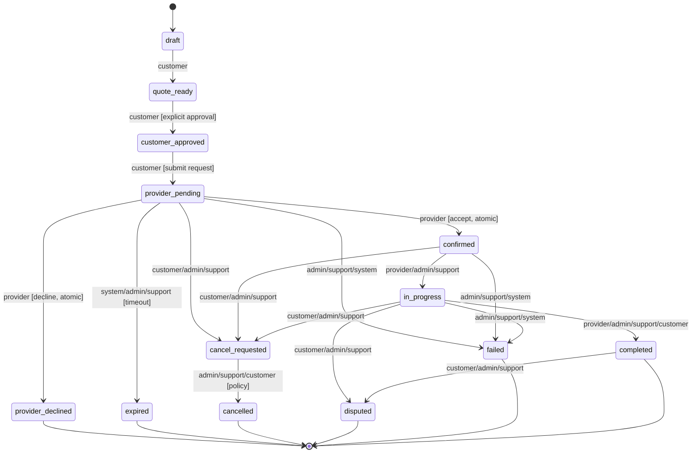

# Booking State Machine Design — Everyday AI Concierge

**Role**: Backend Architect deliverable  
**Scope**: Bengaluru pilot MVP — cleaning, drivers, gardening/general household help  
**Source of truth**: Backend state machine + append-only booking events. AI/UI never bypass transitions.

## 1. Goals

- Make booking lifecycle **explicit, auditable, and enforceable**.
- Ensure **no booking is confirmed** without an authorized provider accepting.
- Ensure **no consequential action** occurs without explicit customer approval (recorded).
- Handle **concurrency, retries, timeouts, and failures** safely.
- Keep the model simple enough for pilot operations, with a clear path to payments/disputes later.

## 2. Core principles

1. **Backend is authoritative.** Clients may request transitions; only the API validates role, ownership, preconditions, and applies atomic updates.
2. **Append-only audit trail.** Every transition writes a `booking_events` row (`from_status`, `to_status`, `actor_id`, `actor_role`, `reason`, timestamp) and relevant domain events.
3. **Idempotency for customer submissions.** `POST /bookings` requires `idempotency_key`; duplicates return the existing booking (409 with `booking_id`).
4. **Atomic accept/decline.** Provider actions use conditional updates (`WHERE id = $1 AND status = 'provider_pending'`) to prevent double-acceptance/races.
5. **Explicit approval.** Customer must pass `confirmation=true` (and have an approved quote context) before a request is sent to a provider.
6. **Honest statuses.** UI and notifications must reflect persisted status only.

## 3. Statuses

| Status | Meaning | Terminal? |
|---|---|---|
| `draft` | Booking being prepared (not yet requestable). | No |
| `quote_ready` | Quote generated; customer can review. | No |
| `customer_approved` | Customer approved quote/terms (pre-submit). | No |
| `provider_pending` | Request sent; awaiting provider response. | No |
| `confirmed` | Provider accepted; booking is confirmed. | No |
| `in_progress` | Service started (provider/admin/support). | No |
| `completed` | Service completed. | Yes (dispute possible by policy) |
| `provider_declined` | Provider declined. | Yes |
| `expired` | Provider did not respond before timeout / policy expiry. | Yes |
| `cancel_requested` | Cancellation requested; requires handling. | No |
| `cancelled` | Cancellation finalized. | Yes |
| `disputed` | Dispute opened post-service/start. | Yes (for MVP workflow) |
| `failed` | System/ops failure path. | Yes |

> Implementation note: MVP routes may compress early steps (quote + explicit confirmation) into a direct `draft → provider_pending` submission event; the **design intent** remains: quote review + explicit customer approval happen before provider notification.

## 4. Transition graph (intended)

## 5. Allowed transitions (policy)

| From | To | Allowed roles | Notes |
|---|---|---|---|
| `draft` | `quote_ready` | customer | |
| `quote_ready` | `customer_approved` | customer | Requires explicit approval |
| `customer_approved` | `provider_pending` | customer | Requires explicit approval; idempotent submit |
| `provider_pending` | `confirmed` | provider | Atomic; provider must be eligible/assigned per flow |
| `provider_pending` | `provider_declined` | provider | Atomic |
| `provider_pending` | `expired` | system, admin, support | Timeout/expiry job |
| `confirmed` | `in_progress` | provider, admin, support | |
| `in_progress` | `completed` | provider, admin, support, customer | Customer confirmation policy can be tightened later |
| `confirmed`/`in_progress`/`provider_pending` | `cancel_requested` | customer, admin, support | |
| `cancel_requested` | `cancelled` | admin, support, customer | Apply cancellation terms |
| `completed`/`in_progress` | `disputed` | customer, admin, support | |
| `provider_pending`/`confirmed`/`in_progress` | `failed` | admin, support, system | |

## 6. Invariants

- **No confirmation without acceptance**: `confirmed` only via authorized provider transition from `provider_pending`.
- **No payment coupling in MVP**: state machine must not assume payment success (payments out of scope).
- **Ownership/authorization**: customers access only their bookings; providers only assigned/eligible bookings; staff by role.
- **Immutability of history**: never delete/overwrite `booking_events`; corrections are new events.
- **Material changes require re-approval**: if price, provider, time, or address changes materially, return to quote/approval flow (do not silently mutate a pending/confirmed booking).

## 7. Concurrency & idempotency

- **Submit booking**: unique `idempotency_key` per customer intent; return existing record on retry.
- **Accept/decline**: `UPDATE ... WHERE status='provider_pending' RETURNING` ensures one winner.
- **Double-submit protection**: DB constraints + idempotency key + conditional transitions.
- **Event ordering**: persist transition + event in a transaction; use `updated_at`/event timestamps; clients poll/refetch by `booking_id`.

## 8. Timeouts & failures

- **Provider response timeout**: background job expires `provider_pending` bookings when policy deadline passes (configure window, e.g., 10 minutes or schedule-aware). Current implementation should be reviewed to ensure timeout is based on **request creation/provider-notified time**, not only scheduled time.
- **Expired UX**: notify customer (stub in MVP) and offer alternatives/re-match; never auto-book another provider.
- **Retries**: safe to retry idempotent submits; transition endpoints should be conflict-safe (409).
- **Partial failures**: if event insert fails after status update, treat as critical; use transactions. If external notification fails, booking state remains correct; queue retry.

## 9. Security & abuse considerations

- Validate all IDs (UUID), enforce ownership/role on every route.
- Rate-limit booking creation/accept/decline.
- Reject transitions not in `ALLOWED_TRANSITIONS` (defense in depth even if routes use conditionals).
- Log actor, IP/context (privacy-aware), and reason for admin/system actions.
- Never expose internal errors; return stable error codes (`validation_error`, `forbidden`, `not_found`, `conflict`).

## 10. Data model (minimum)

- `bookings`: `id`, `quote_id`, `customer_id`, `provider_id` (nullable until assigned), `status`, `idempotency_key`, `scheduled_at`, `address_id`, `total`, `cancellation_terms`, `confirmed_at`, timestamps.
- `booking_events`: `booking_id`, `from_status`, `to_status`, `actor_id`, `actor_role`, `reason`, `created_at` (append-only).
- `provider_responses`: records accept/decline decisions.

## 11. Observability

- Structured logs: `bookingId`, `from`, `to`, `actorRole`, `idempotencyKey`, `reason`.
- Metrics: transition counts, time-in-state, expiry rate, decline rate, conflict (409) rate, double-accept attempts (should be 0 successful duplicates).
- Alerts: spike in `failed`/`expired`, conflict anomalies, stuck `provider_pending`.

## 12. Known implementation gaps to address (MVP hardening)

1. **Provider assignment/identity**: ensure `provider_id` references the correct provider profile and accept/decline verifies the acting provider owns the pending request.
2. **Expiry basis**: base timeout on request age/notification time, not solely `scheduled_at < now`.
3. **Route ↔ state machine parity**: routes should call `isAllowedTransition` (or share a single transition service) for all paths, not only some.
4. **Transactions**: wrap status update + `booking_events` + response records atomically.
5. **Customer completion/cancellation policy**: define who can mark `completed`/`cancelled` and under what terms (pilot ops).

## 13. Testing checklist

- Valid/invalid transitions per role.
- Idempotent duplicate submit returns same booking.
- Concurrent accept attempts → exactly one `confirmed`.
- Accept after expiry/decline → 409.
- Ownership checks (customer/provider/admin).
- Timeout job expires only eligible `provider_pending` rows.
- Audit event written for every successful transition.

---
**Status**: Design baseline for pilot; implementation should be hardened against §12 before production-scale pilot.